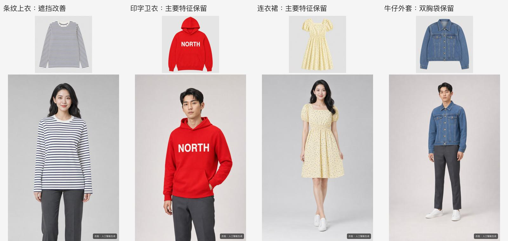

# 衣拍 Yipai

手机优先的 AI 模特商品图工具：上传服装商品图、选择男女模特、生成模特上身图，并对照原图检查、保存或发布到社区。



## 功能

- 创作工作台：上传入口、草稿继续、进行中任务和创作历史。
- 图片生成：男女模特参考、异步排队、状态轮询和失败重试。
- 开拍：上传一张商品图、选择模特，即可生成模特上身图。
- 拍同款：上传拍摄参考照和上装／下装或连体商品图，可添加模特身份图及服装细节图，默认每张参考生成 3 张独立成片。
- 结果检查：商品原图切换、全屏放大、下载和系统分享。
- 社区：主动发布效果图、商品原图和心得；支持撤回。
- 可靠性：匿名会话隔离、幂等提交、单用户单进行中任务和服务端水印。
- 姿势裂变：选择 4 / 6 / 8 个姿势，分别生成独立图片；结果页逐张查看、保存，也支持打包下载。旧版宫格任务会在服务启动时拆为单图，原宫格文件保留。
- 响应式界面：手机底部导航，平板与桌面使用宽工作区。

## 运行创作工作台（真实生成）

需要 Python 3.9+；建议使用独立虚拟环境。

```sh
git clone https://github.com/BBear0115/yipai.git
cd yipai
python3 -m venv .venv
source .venv/bin/activate
python3 -m pip install -r requirements.txt
cp .env.example .env.local
# 在 .env.local 中填写 IMAGE2_GATEWAY_API_KEY
YIPAI_PORT=8018 python3 -m backend.server
```

打开 <http://127.0.0.1:8018/>。首页「开拍」上传单张商品图做模特上身，「拍同款」按参考照搭配拍摄，「创意裂变」做换姿势和换背景，所有作品都在「我的」。该服务会处理上传原图并调用真实图片生成接口；背景替换保留原图主体，商品图不会自动添加模特。历史与图片保存在 `backend/data/`，重启后保留。

拍同款支持只换上装、只换下装、同时换上下装，以及换连体服装，至少需要一件商品和一张拍摄参考照。最多 8 张参考照分别控制姿势、场景、光线和未替换的穿搭；每张参考可生成 1、2 或 3 张独立成片，默认 3 张，最多交付 24 张。模特图只控制人物身份；服装细节最多 4 张，需归属对应的上装、下装或连体服装。开拍与拍同款的草稿独立。图片与角色随任务保存，刷新、重试和重新生成会保留原始输入。

同时选择拍摄参考图和模特身份图时，每张结果会额外调用一次身份校准，保留已生成的服装和场景，减少参考人物对所选模特的影响；此时生成耗时和调用量会增加。

## 界面演示（无需生图密钥）

```sh
python3 testing/preview_server.py --port 8019
```

打开 <http://127.0.0.1:8019/>。演示使用固定样例模拟排队与生成，不处理上传图片、不调用图片服务。页面会显示演示模式提示；数据存入临时目录并在退出后清理。可增加 `--empty` 查看空工作台，或 `--large-text` 检查 200% 根字号布局。

真实生成通过 Image2 网关调用 `gpt-image-2.5-sunburst`，需要相应接入权限，并可能产生供应商费用；普通静态服务器无法运行生成接口。密钥只保存在服务端，环境变量优先于 `.env.local`。如网关要求接入方标识，可额外设置 `IMAGE2_UUAP_ID`。

「拍同款」把商品、拍摄参考和人物身份分别传给图片服务。可选在 `.env.local` 设置 `ANALYZE_API_KEY`，先由独立视觉模型分析参考图的拍法；默认分析网关为 `http://z.duxiaoman-int.com/coding/v1`、模型为 `gpt-6.1-sol`，可用 `ANALYZE_BASE_URL`、`ANALYZE_MODEL` 覆盖。未配置独立分析服务时，由现有图片服务直接读取参考图并按不同拍法生成，不复用图片服务密钥访问分析网关。

默认数据目录为 `backend/data/`；可用 `YIPAI_DATA_DIR` 指定其他目录，用 `YIPAI_PORT` 修改端口，用 `IMAGE2_ENV_FILE` 指定配置文件。真实服务在 macOS 上使用苹方字体合成中文水印；其他系统需要按源码配置可用的中文字体并验证水印。

## 技术与目录

当前使用原生 HTML/CSS/JavaScript、Python 标准库 HTTP 服务、SQLite、Pillow 和本地文件存储，无前端构建步骤。

```text
mockup/       手机优先前端、模特与社区示例素材
backend/      任务与社区 API、图片处理、自动化测试
scripts/      模特素材生成脚本和提示词
testing/      隔离预览、前端测试、记录图片与验收报告
research/     Onepage 竞品调研依据与公开资料留存
```

流程为：上传校验 → 幂等建任务 → 限流队列 → 图片生成 → 水印处理 → 原图对照 → 保存或主动发布。接口与配置细节见 [运行及 API 说明](mockup/README.md)。

## 测试

安装依赖后执行；JavaScript 检查另需 Node.js 18+。

```sh
python3 -m unittest discover -s backend -v
node --check mockup/app.js
node --check mockup/community.js
node --test testing/frontend.test.cjs
```

本次合并后，后端 43 项、前端 58 项自动化测试通过；测试使用模拟网关和临时数据库。早期手机交互验证详见 [前端优化验收](testing/2026-11-11/前端优化验收.md)。`testing/2026-11-10/run_live.py`、`generate_fixtures.py` 和 `scripts/generate_models.py` 属于真实服务测试或素材生成脚本，执行时可能产生费用。

## 项目文档

- [Onepage（末尾含 Demo）](衣拍_Yipai_Onepage.md)
- [产品说明](衣拍_产品说明文档_v1.0.md)
- [PRD](衣拍_AI模特生图工具_PRD_v1.0.md)
- [个人页与社区说明](衣拍_个人页与社区说明_v1.1.md)
- [真实生成测试报告](testing/2026-11-10/测试报告.md)
- [前端优化验收与手机截图](testing/2026-11-11/前端优化验收.md)
- [竞品调研依据与测算口径](research/onepage/调研依据与测算口径.md)

## 当前边界

这是本地单进程演示版本，默认只监听回环地址。历史依赖当前浏览器 Cookie，尚不含跨设备账号、支付、批量生成或自动质检；生成结果需人工核对商品细节。测试商品原图为 AI 合成素材，生成效果不能替代真实商家样本的质量验证。公网部署还需配置 HTTPS、进程托管、持久化存储和供应商配额。
