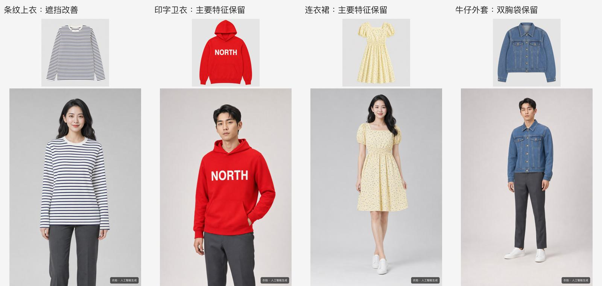

# 衣拍完整流程与服装效果测试报告

日期：2026 年 11 月 10 日  
测试对象：当前本地手机优先版本，真实 Image2 服务  
结论：**功能回归通过；4 类测试服装的主要可见特征基本保留，但不能据此承诺所有商品准确还原。**

## 1. 执行范围与结论

本轮生成 4 张服装商品测试图，完成 6 次真实模特生成（4 次初测、2 次复测）。共调用图片服务 10 次，未自动重试失败计费请求。未获得供应商实际计费数据。

后端 15 项自动化测试与前端 5 项逻辑测试全部通过。浏览器实际验证了上传、模特选择、生成、刷新恢复、原图对比、重新生成、下载、水印、历史和删除。异常校验与小屏、桌面布局也完成检查。

服装效果中，卫衣和连衣裙主要可见特征保留较好；条纹上衣复测后遮挡改善；牛仔外套原图有左右两个胸袋，初测和复测都保留了双胸袋。先前基于缩略图判断为“增加口袋”是误判，已放大原图纠正。

这是一轮有限样本验证，不是全设备、全品类或生产环境认证。AI 生成商品原图不等同于真实商家照片测试，鞋款本轮未测。



## 2. 测试服装与视觉检查

评价基准是实际生成的商品原图，而不是制作原图时的文字要求。牛仔外套原图有左右两个带翻盖胸袋，判断必须基于放大后的原图。

| 样本 | 模特 | 检查内容 | 结果 |
|---|---|---|---|
| 白底海军蓝条纹长袖上衣 | 女 | 圆领、长袖、横条纹、颜色、衣身可见性 | 初测头发遮挡、下摆被提起；复测双手下垂、下摆完整。基本外观可用，未做条纹逐根及像素级一致性验证 |
| 红色 NORTH 卫衣 | 男 | 英文拼写、红色、连帽、袋鼠口袋、罗纹 | 主要特征保留，文字可读且拼写正确；初测约 80.3 秒 |
| 黄色花卉连衣裙 | 女 | 方领、泡泡袖、腰部收褶、花色、裙摆 | 主要特征保留，花纹排列并非逐位置复制；初测约 80.2 秒 |
| 双胸袋蓝色牛仔外套 | 男 | 胸袋数量、六枚前襟纽扣、翻领、面料 | 初测和复测均保留双胸袋、翻领和六枚前襟纽扣；初测约 104.3 秒，复测约 100.3 秒。精细缝线位置未做严格比对 |

耗时为对应本地接口提交到轮询发现完成，包含排队和轮询间隔，不代表稳定服务时延。

原图与结果：

- [条纹原图](striped-shirt.png)、[初测](striped-shirt-result.jpg)、[复测](striped-shirt-v2-result.jpg)
- [卫衣对照](red-hoodie-comparison.jpg)
- [连衣裙对照](floral-dress-comparison.jpg)
- [牛仔外套原图](denim-jacket.png)、[初测对照](denim-jacket-comparison.jpg)、[复测结果](denim-jacket-v2-result.jpg)

## 3. 浏览器功能验证

| 项目 | 验证方式 | 结果 |
|---|---|---|
| 主页与模特选择 | 无登录直接进入，切换女模特 | 通过 |
| 图片上传 | 用真实生成的条纹商品图进入准备页 | 通过 |
| 真实生成 | 页面提交条纹上衣，后台返回带水印结果 | 通过 |
| 刷新恢复 | 生成中刷新，再进入创作历史 | 任务保留、状态更新正常 |
| 重新生成 | 在条纹作品中点击重新生成 | 产生新结果，原记录保留 |
| 原图对比 | 原图和生成图来回切换 | 图片展示正常，切回不会裁掉水印 |
| 保存 | 浏览器下载事件，检查实际 JPEG 文件 | 通过，下载文件含像素水印 |
| 历史与删除 | 删除本轮已备份的旧条纹作品，两次确认 | 记录从历史移除，复测结果保留；未删除原有用户作品 |
| 过小图片 | 上传 100 × 100 PNG | 前端提示尺寸不足，不发起生成 |
| 损坏图片 | 上传损坏 PNG | 提示无法读取 |
| 布局 | 检查 320 × 568、390 × 844 手机布局及 1440 × 900 桌面布局 | 主要操作可见；小屏通过滚动浏览卡片 |
| 浏览器脚本错误 | 读取错误日志 | 未发现脚本错误 |
| 分享 | 前端逻辑测试覆盖不支持时保存转发、取消原生分享 | 通过；未向联系人发送，未做 iOS/Android/微信真机分享认证 |

截图：[小屏主页](home-320.jpg)、[桌面主页](home-desktop.jpg)、[手机结果页](mobile-result.jpg)。

## 4. 本轮修复

1. **提交期间状态竞争。** 历史同步可能把提交中的忙碌状态清掉。新增独立提交标记，阻止重复发起提交，并加入回归测试。
2. **失败后模特不一致。** 重新生成提交失败时，准备页可能恢复为主页选择的模特。现在沿用该次提交的模特。
3. **小图校验太晚。** 现在前端转换后就检查短边，避免进入生成流程后才报错。
4. **异常请求返回不准确。** 非对象 JSON、无效 JSON/编码现在统一返回中文 400 错误，不再落入泛化服务错误。
5. **伪装图片格式。** 服务端除了检查 Data URL，还检查解码后的真实格式，拒绝伪装成 PNG 的 GIF。
6. **商品遮挡。** 生图指令增加双手自然下垂、不插兜、不提拉下摆、头发放肩后的要求；条纹样本复测改善。
7. **结构约束。** 增加口袋、纽扣数量与位置约束，强调不凭常见款式补全。该项未经过单侧口袋样本验证；本轮牛仔外套为双胸袋，不构成反例。

当前仍保持简洁界面，没有新增设置项或说明面板。

## 5. 自动化回归证据

执行命令：

```sh
python3 -m unittest discover -s backend -v
node --test testing/frontend.test.cjs
node --check mockup/app.js
```

- [后端日志：15 项通过](backend-tests.txt)：输入解码、异常请求、格式伪装、参数及请求体积、重复提交并发、访客隔离、删除、队列、跨来源请求、配置缺失、服务重启、网关失败脱敏、真实请求结构、静态配置隔离、Cookie 属性、水印等。部分测试含多个断言。
- [前端日志：5 项通过](frontend-tests.txt)：提交锁、失败后幂等键复用与模特恢复、重新生成原图与模特、分享降级、取消分享。
- 前端语法检查通过。

API 实测记录：[卫衣](red-hoodie-run.json)、[连衣裙](floral-dress-run.json)、[牛仔初测](denim-jacket-run.json)、[牛仔复测](denim-jacket-v2-run.json)。三个初测及牛仔复测均验证重复提交返回同一任务，历史只增加一条。

## 6. 未覆盖风险与后续建议

**高优先级：商品结构忠实度验证。** 本轮 4 类合成商品的主要特征基本保留，但样本量小，且没有测试不对称口袋、复杂标识和真实商家照片。当前应保留人工原图对比，不能把模型返回成功视为商品质量验收通过。下一步应使用真实商家样本做口袋、纽扣、文字和印花专项评测，并评估独立细节检测方案。

**尚未验证：** 真机相册保存、各社交平台分享、鞋类、多品类批量统计、生产负载、长时间运行、跨设备同步、真实商品颜色管理、内容审核与公网部署安全。当前无账号和跨设备同步能力。

## 7. 素材与复现

本轮使用用户已授权的 Image2 网关生成测试图，未使用内置图片工具。完整测试素材提示词保存在 [generate_fixtures.py](generate_fixtures.py)，产品生图提示词在 `backend/server.py` 的 `prompt_for` 中。当前提示词已包含本报告所述三条新增结构与姿态约束。

[run_live.py](run_live.py) 可通过本地 HTTP API 运行实测，已有记录会跳过以避免重复计费。脚本不保存凭据或浏览器会话；复测请使用新的样本名称，避免覆盖已有证据。
