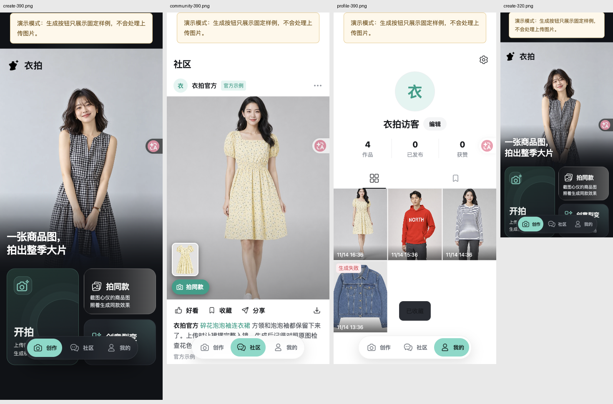

# 13 个圆角图标接入验收

2026-11-14。保留实施前已有未提交改动；项目及祖先目录未发现适用的 AGENTS.md。

## 修改

- `mockup/index.html`：底部创作、社区、我的三个 PNG 图标，并更新修改文件的缓存版本。
- `mockup/app.js`：限定名称的 PNG 图标 helper；开拍、拍同款、创意裂变三个入口；设置、收藏、四方格作品集入口。
- `mockup/community.js`：点赞、收藏、分享、保存四个操作图标，保留原有事件和状态逻辑。
- `mockup/styles.css`：PNG alpha mask、currentColor、显示尺寸及窄屏适配。
- `mockup/assets/icons-rounded/`：13 个 128px 透明 PNG，与确认素材逐字节一致。

## 检查结果

- `node --check mockup/app.js`、`node --check mockup/community.js`：通过。
- `node --test testing/frontend.test.cjs`：现有 30 项全部通过。
- `git diff --check`：通过。
- Tabbit 实际浏览器：390×844 手机、320×640 窄屏、1280×900 桌面；三页无横向溢出，13 种图标均获得 HTTP 200，页面脚本未产生未捕获异常。
- 导航选中态随页面切换；深色创作页和浅色社区/个人页均可见。
- 开拍打开拍照/相册选择弹层；拍同款卡片进入社区；创意裂变打开原有流程。
- 点赞计数与颜色反馈正常，图标在计数更新后保留；收藏提示和颜色正常。刷新后状态保留，收藏出现在“我的”收藏页；测试后恢复原有点赞/收藏状态。
- 分享触发“分享图片/请保存后转发”回退弹层；保存发起下载并提示。
- 个人页作品/收藏切换、四方格作品图标和作品列表、设置弹层正常。

使用已有 8019 演示页面进行交互检查，并启动 `python3 testing/preview_server.py --port 8027` 在隔离临时数据库复核和截图；均未调用真实图片生成服务。8019 旧演示会话中有一张作品图无法加载，8027 新演示的四张作品图均完整加载。新演示启动时曾出现模特库加载失败提示，本次未修改模特库或后端；验证范围是指定图标和上述交互。

## 截图

- [创作页 390px](create-390.png)
- [社区页 390px](community-390.png)
- [个人页 390px](profile-390.png)
- [创作页 320px](create-320.png)
