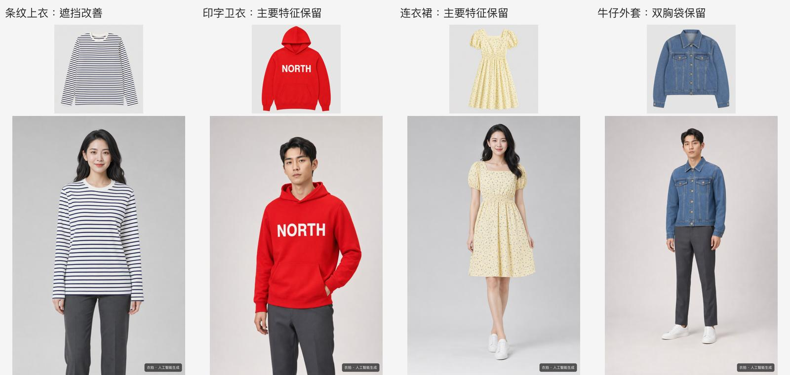

# Yipai 衣拍｜Onepage

2026.11.10｜服装商家 AI 模特商品图工具

### 一句话描述：目标客群与产品设计

**给需要频繁上新的中小服装商家一个手机端 AI 模特拍图工具，让他们能把商品实拍转成可核对、可下载的模特上身图，用于店铺上新和社群推广。** 商家上传商品图、选择模特即可生成，无需写提示词，并可对照原图检查、重新生成和保存分享。已有商家调研反馈显示需求明确、付费意愿较高，主要动机是减少真人模特拍摄支出，但通用产品如豆包的效果时好时坏。[1]

### 一、市场规模和需求判断

**1．市场有多大，为什么付费，如何定价和获客？**

AI 模特商品图已有商业需求：Botika 官网自报服务超过 3,000 个时尚品牌、月产超过 50 万张图片及视频，表明该场景已有规模化使用。[2] 按“活跃付费商家数 × 月均实收 × 12”测算：假设月均实收 99 元，1,000／10,000／50,000 家对应年收入约 119 万／1,188 万／5,940 万元。建议以 **99 元／月、含 30 次生成**作为价格测试起点，商家购买的是能替代一部分拍摄的可用图片，定价需覆盖推理、失败重试和售后成本。竞品 Attired 的小店套餐约为 200 元／月、含 100 张图片及 50 次重生成或编辑，可作为订阅加额度定价的参考。[3] 获客优先面向服装批发档口、店主社群和现有受访商家，以同款商品的原图与成图对照促成试用及转介绍。

**2．目标用户是谁，具体痛点是什么？**

**目标用户是上新时手里只有平铺或挂拍商品图、需要给每款衣服补模特上身图，却要另约模特拍摄，或在通用 AI 工具中反复重试并逐张核对衣服细节的小服装店主。** 公开商家评价提供了交叉支撑：DUE. 表示使用 Attired 是为了避免组织整场拍摄，Rainqueen Rainwear 则指出并非所有设计都能准确生成。[3] 因此核心需求是“在能承受的价格内，稳定得到不改错商品的展示图”。

### 二、潜在机会验证

**1．是否有人在做，成熟度如何？**

已有专用产品形成收费、批量出图和店铺工作流，品类已进入商业应用阶段。[2–4] 竞争已从“能否生成”转向商品还原、批量交付与品牌一致性。衣拍优先面向手机操作的小商家，以少量选择、原图核对和直接保存分享缩短操作流程。

| 玩家 | 产品做什么／目标客群 | 商业模式与收费 | 商业化与用户反馈 |
|---|---|---|---|
| **Botika** | 平铺、人台图转模特图及视频；面向服装品牌 | 订阅积分制，官网 FAQ：照片 1 积分、视频 5 积分；企业定制 | 自报 3,000+ 品牌；付费方案包含修图服务及企业质检 [2] |
| **Attired** | 无需提示词，批量生成并发布到 Shopify 商品页；面向小店及成长品牌 | Starter 约 ¥200／月：100 张＋50 次重生成／编辑；Pro 约 ¥400／月：250 张＋100 次 [3] | Shopify 4.9 分／13 条评价；商家认可免拍摄，也反馈款式还原不完整 |
| **Modelia** | 服装转模特图、换姿势、视频；面向 Shopify 时尚商家 | 免费 50 积分／月；Basic 约 ¥234／月、250 积分；另有一次性积分包 [4] | Shopify 4.8 分／8 条评价；Yotti 反馈包带长度偶尔变化，说明配饰细节仍会漂移 |

**2．为什么是 AI 机会，壁垒在哪里？**

没有生成式 AI，单张平铺图转自然上身图通常需要真人拍摄、人工合成或逐款三维建模，难以在小商家预算内为频繁上新的商品持续交付；AI 改变的是这一成本结构。衣拍现有 4 类合成服装样本已跑通真实生成，卫衣、连衣裙和牛仔外套初测约 80–104 秒，但出现过遮挡、花纹位置不一致。[5] 拟通过 **专有数据＋工作流嵌入** 建立壁垒：在商家授权下积累“商品原图—错在哪里—修正结果—是否采用”的细节评测数据，用于优化品类策略与质检，并让商品素材、常用模特和历史作品可持续复用。差异化目标是提高图片采用率，降低每张可用商品图的总成本。

### 三、技术选型与架构

**选什么技术，如何支撑可靠交付？**

当前采用手机优先的 HTML／CSS／JavaScript 前端，Python HTTP 服务处理任务，SQLite 保存状态、本地目录存图，通过服务端 Image2 网关调用项目配置的 `gpt-image-2`，以商品图和模特参考图共同约束生成。[6] 核心链路为 **上传与校验 → 幂等建任务 → 限流队列 → 图片生成 → 水印处理 → 原图对照 → 保存／分享**，已有匿名会话隔离、历史记录和失败重试入口。面向正式服务建议采用 FastAPI＋PostgreSQL＋Redis 任务队列＋对象存储，把推理放到独立 Worker，并通过模型适配层保留替换供应商的能力。质量层建议加入口袋／纽扣／标识等细节检查与问题反馈，以商家最终确认兜底，同时记录每张采用图片的调用、重试和存储成本；密钥留在服务端，素材存储与公开分享分别授权。

---

**来源与口径：** [1] 商家调研反馈（2026-11-10 汇总）；[2] [Botika 官网](https://www.botika.io/)及[价格页](https://www.botika.io/pricing)；[3] [Attired：Shopify 产品、定价与商家评论](https://apps.shopify.com/attired)；[4] [Modelia：Shopify 产品、定价与商家评论](https://apps.shopify.com/modelia)；[5] [项目已有测试报告](testing/2026-11-10/测试报告.md)；[6] [后端源码](backend/server.py)及[前端源码](mockup/app.js)。网页均于 2026-11-10 核查，人民币价格为页面汇率估算；详见[调研依据与测算口径](research/onepage/调研依据与测算口径.md)。

### Demo｜商品原图 → 模特上身图

**操作流程：上传商品图 → 选择男女模特 → 生成 → 对照原图 → 保存分享。** 图中为 4 类 AI 合成商品测试图及真实接口生成结果，卫衣的 NORTH 字样、连衣裙的方领泡泡袖、牛仔外套的双胸袋等主要特征得到保留，条纹上衣复测后遮挡改善。[5] 本轮完成 6 次模特生成，卫衣、连衣裙和牛仔外套初测耗时约 **80–104 秒**；上传、刷新恢复、原图对比、重新生成、下载和历史管理流程通过验证，后端 15 项及前端 5 项自动化测试通过。[5]

[打开本地 Demo](http://localhost:8000/)（需先按[运行说明](mockup/README.md)启动服务） · [手机结果页截图](testing/2026-11-10/mobile-result.jpg) · [完整测试报告](testing/2026-11-10/测试报告.md)
